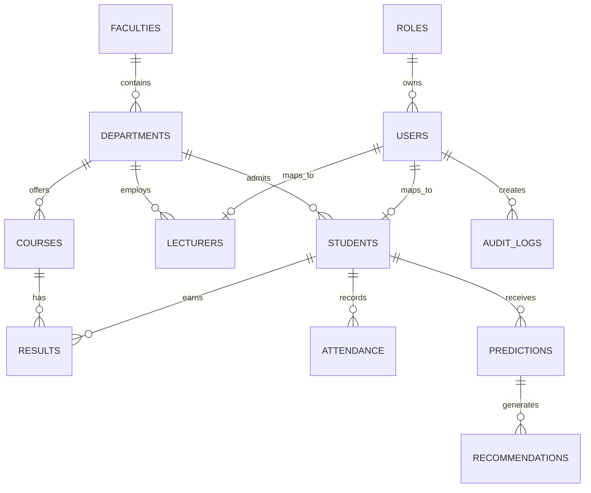
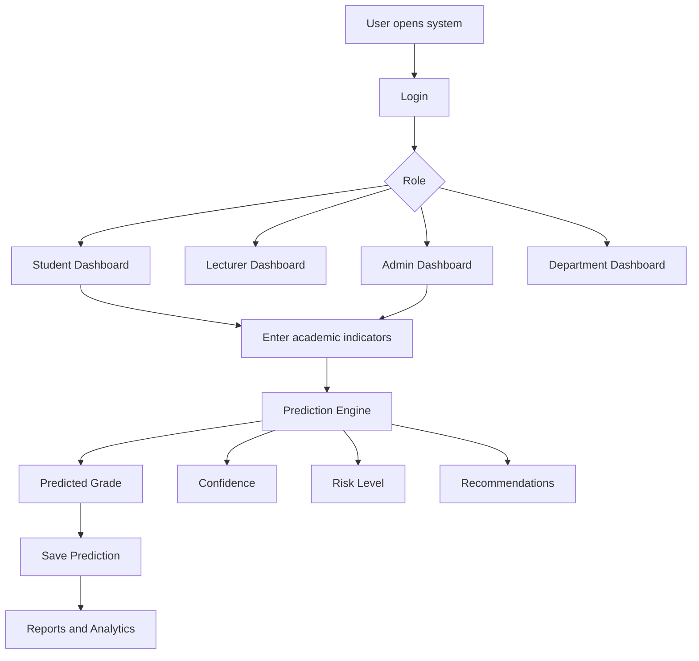
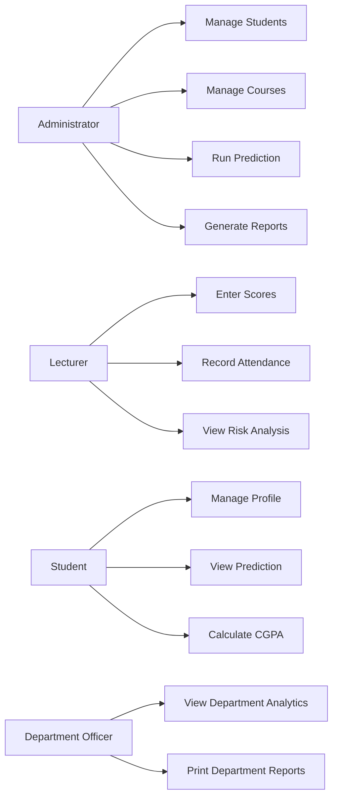
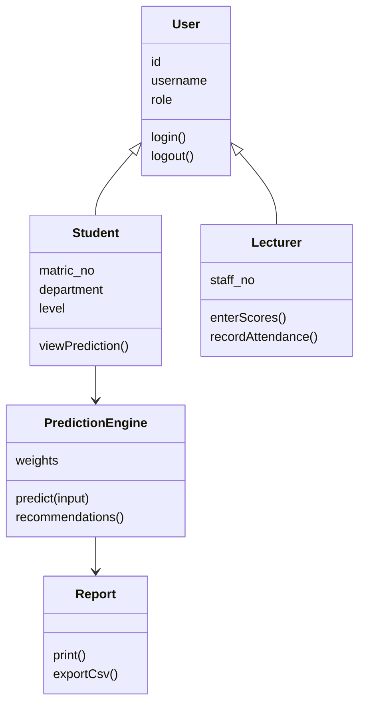
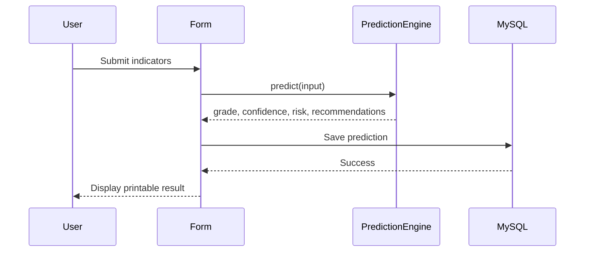
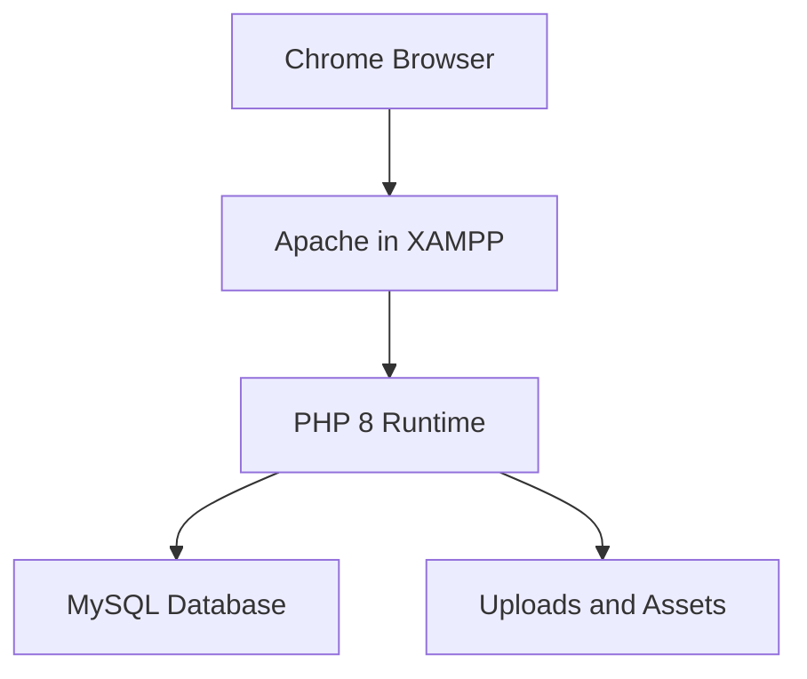

# System Documentation

## Architecture

The system uses a simple MVC-style PHP structure:

- `config/` stores database and application settings.
- `includes/` stores shared helpers for authentication, database access, security, and formatting.
- `models/PredictionEngine.php` stores the intelligent prediction logic.
- `admin/`, `lecturer/`, `student/`, and `department/` store role-based modules.
- `reports/` and `exports/` store printable and downloadable reports.
- `database/database.sql` creates and seeds the MySQL database.

## Prediction Engine

The prediction engine considers:

- Continuous assessment (CA) score.
- Attendance percentage.
- Test score.
- Previous CGPA.
- Assignment score.
- Study hours per week.
- Health status and financial challenges (combined as a constraint flag).

The factors are weighted (CA 0.24, attendance 0.18, test 0.17, previous CGPA 0.16, assignments 0.10, study hours 0.08, constraints 0.07; total 1.0).

The engine returns:

- Predicted class of degree.
- Predicted GPA.
- Probability score.
- Confidence percentage.
- Risk level.
- Recommendations.

## Security

The project includes:

- PDO prepared statements.
- Password hashing.
- CSRF tokens on forms.
- Session regeneration on login.
- Output escaping.
- Basic brute-force login attempt limiting.
- Role-based authorization.

## ER Diagram

## Flowchart

## Use Case Diagram

## Class Diagram

## Sequence Diagram

## Deployment Diagram

## Suggested AI Model Training Enhancement

For a stronger defense, historical student data can be used to train a Decision Tree or Random Forest offline. The trained model can then be exported to JSON and loaded by PHP at runtime. This deployment still requires no Python on the examiner's computer.
